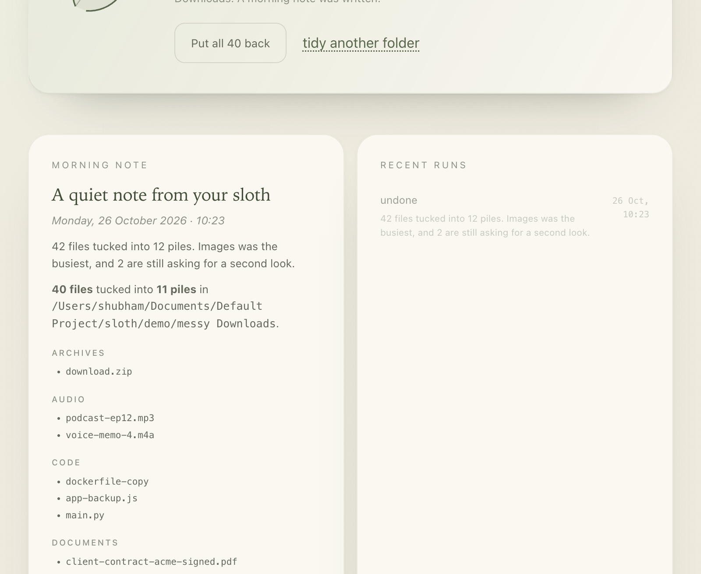
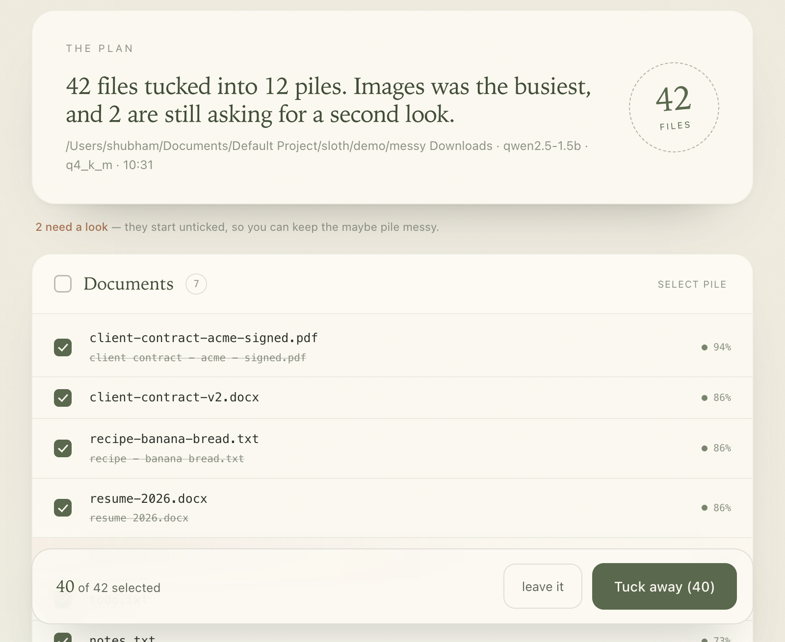
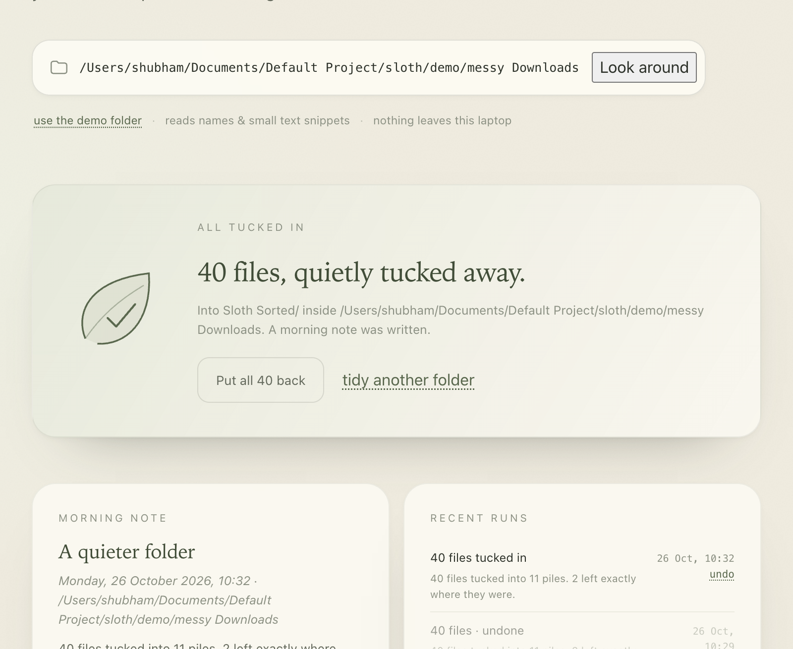

# Sloth

**A slow, offline file tidier that runs entirely on your laptop.**

Point Sloth at a messy folder. It reads the files, groups them into piles, renames them into something readable, and shows you the whole plan before a single byte moves. Then it tucks everything into `Sloth Sorted/` and leaves a short morning note.

The model is [Qwen2.5-1.5B-Instruct](https://huggingface.co/Qwen/Qwen2.5-1.5B-Instruct-GGUF) (Apache-2.0), running locally through [llama.cpp](https://github.com/ggml-org/llama.cpp). No account, no API key, no cloud, no telemetry. The app is Python standard library only — there is nothing to `pip install` at runtime.



## Why

File cleanup is the kind of chore that never gets easier and never feels worth doing. Sloth is built for the lazy version of that: one command, a plan you can actually read, and an undo button. You get to be a little lazier because the boring part happened while you were doing something else.

It is also deliberately slow. The model reads a handful of files at a time, and the UI shows you what it is thinking about. Speed is not the point; trust is.

## Quick start

Requirements: macOS or Linux, Python 3.9+, CMake (or a Python environment, `setup.sh` will create one), and about 2 GB of disk for the engine and weights.

```bash
git clone https://github.com/kondekarshubham123/sloth.git
cd sloth
./setup.sh          # builds llama.cpp, fetches ~1 GB of weights, makes a demo folder
./sloth doctor      # verifies everything is local
./sloth ui --open   # http://127.0.0.1:8765
```

The first build compiles llama.cpp and takes a few minutes. After that, everything is offline.

No model? Sloth still works:

```bash
./sloth scan --no-model
```

It falls back to a small, deterministic rule engine and says so in the plan.

## Commands

| Command | What it does |
| --- | --- |
| `./sloth scan [folder]` | Read a folder and draft a plan. Nothing moves. |
| `./sloth apply [plan_id] --yes` | Move the files in a plan into `Sloth Sorted/`. |
| `./sloth undo [run_id]` | Put the last run back, file by file. |
| `./sloth ui [--port 8765] [--open]` | Start the local dashboard. |
| `./sloth night --once --apply` | Tidy now without asking, then write the morning note. |
| `./sloth night --at 03:00 --repeat --apply` | Keep a nightly quiet pass running. |
| `./sloth doctor` | Check the model, engine, airgap, and storage. |
| `./sloth demo` | Rebuild the messy demo folder. |
| `./sloth models` | Show the active model and how to swap it. |

`scan` defaults to the demo folder, so the first run is safe to try.

## What a plan looks like



Every row shows the new name, the old name, the model's reason, and a confidence score. Low-confidence and `Unsorted` files start **unticked** — the maybe pile stays messy unless you say otherwise.

After applying, you get a receipt and a note:



The note lives at `~/.sloth/briefings/<date>.md` and is written in plain Markdown. The dashboard renders it locally with a tiny built-in Markdown function.

## How it works

```
folder ──> scanner ──> planner ──> review (CLI / local UI) ──> store ──> Sloth Sorted/
                          │                                      │
                          ├── rule hints (types, names)          ├── journal
                          └── Qwen2.5-1.5B via llama.cpp         ├── undo
                              on 127.0.0.1:8099                  └── morning note
```

1. **Scanner** walks the folder, skips junk (`.DS_Store`, partial downloads, existing `Sloth Sorted/`, symlinks, nested archives), and reads a bounded text snippet from readable files.
2. **Planner** sends small batches to a locally spawned `llama-server`, asking for strict JSON: bucket, new name, reason, confidence.
3. **Rule engine** supplies a hint for every file and reconciles the model's answer. Objective evidence wins: an `.mp3` is Audio, a file named `screenshot...` is Screenshots, a boarding pass is Travel. Semantic corrections are conservative and visible in the `why` line. Bogus date prefixes are stripped.
4. **Review** happens before any move. The CLI prints the whole plan; the UI renders it as piles with checkboxes.
5. **Store** performs the moves, writes a JSONL journal, and can reverse a whole run. Nothing is ever deleted.

The result is a hybrid: the model handles ambiguity and naming, while deterministic rules catch the confident mistakes a 1.5B model occasionally makes.

## Privacy and the airgap

Sloth is local-first by construction, not by promise:

- `netguard.py` installs a socket-level guard that refuses non-loopback connections for the life of the process.
- The UI and API bind to `127.0.0.1` only.
- `llama-server` is spawned with `--host 127.0.0.1` and no remote endpoint.
- The dashboard loads no CDN, no web fonts, no analytics, and no external assets. The illustrations are inline SVG.
- Plans, runs, notes, and logs live in `~/.sloth/`.

`./sloth doctor` reports the airgap state along with the model checksum. The only time Sloth needs the network is `./setup.sh`, when it clones llama.cpp and downloads the weights from Hugging Face.

## Choosing a model

Any GGUF that llama.cpp can run will work. Point `SLOTH_MODEL` at it:

```bash
SLOTH_MODEL=/path/to/your-model.gguf ./sloth scan ~/Downloads
```

Useful knobs:

| Variable | Default | Meaning |
| --- | --- | --- |
| `SLOTH_MODEL` | `models/qwen2.5-1.5b-instruct-q4_k_m.gguf` | Local weights |
| `SLOTH_LLAMA_SERVER` | `vendor/llama.cpp/build/bin/llama-server` | Inference binary |
| `SLOTH_MODEL_PORT` | `8099` | Loopback port for the model |
| `SLOTH_UI_PORT` | `8765` | Dashboard port |
| `SLOTH_BATCH` | `6` | Files per model call |
| `SLOTH_CTX` | `4096` | Context window |
| `SLOTH_MAX_FILES` | `60` | Default scan cap |
| `SLOTH_HOME` | `~/.sloth` | Plans, runs, notes |

A 3B or 7B model will generally name files better. A 1.5B model is the sweet spot for a laptop: about 1 GB on disk, a few seconds per batch, and good enough once the rules do the boring guardrail work.

## Tests

```bash
python3 -m unittest discover -s tests -v
```

Twelve tests cover name sanitising, JSON extraction from chatty model output, scanner skip rules, bucket fallbacks, path-escape refusal, idempotent apply, undo, and the network guard.

## Project layout

```
sloth/
├── sloth                 # launcher
├── sloth.py              # entry point
├── setup.sh              # build engine + fetch weights
├── src/sloth/
│   ├── cli.py            # scan / apply / undo / ui / night / doctor
│   ├── config.py         # paths, buckets, system prompt
│   ├── llm.py            # llama-server lifecycle + chat client
│   ├── netguard.py       # socket-level airgap
│   ├── planner.py        # batching, hints, reconciliation, naming
│   ├── scanner.py        # folder walk + snippet extraction
│   ├── server.py         # stdlib HTTP API + NDJSON scan stream
│   ├── store.py          # plans, apply, journal, undo, briefing
│   └── ui/               # index.html, style.css, app.js
├── tests/test_core.py
├── demo/make_demo.py
└── docs/                 # screenshots
```

## Limitations, honestly

- The model is small. It will occasionally suggest an odd name; the rules and the review step exist because of that.
- PDFs, images, and Office documents are not deeply parsed — Sloth uses the filename, extension, size, and dates. Text-like files get a short snippet.
- `Sloth Sorted/` is a flat set of bucket folders, not a taxonomy. That is intentional.
- Undo restores moves from a journal; it does not resurrect a file you deleted yourself.
- Tested on macOS with Apple Silicon (Metal). CPU and Linux builds of llama.cpp should work but are not part of the demo.

## License

MIT for the code. The Qwen2.5-1.5B-Instruct weights are Apache-2.0; llama.cpp is MIT. See [LICENSE](LICENSE).

Built for [Hacktoberfest Open-Source AI Challenge Week 3: Slow and Steady](https://dev.to/challenges/hacktoberfest-week3-2026-10-19).
